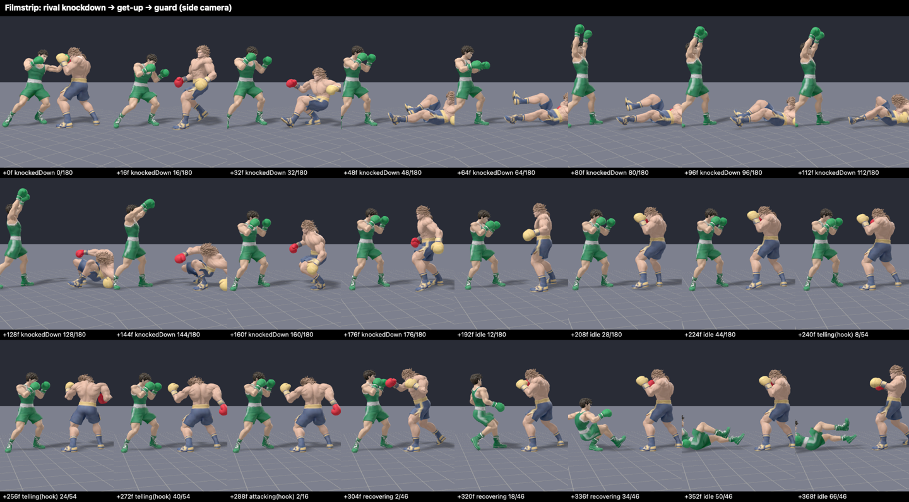

# Character model source assets

These ten OBJ files were supplied by the user for character integration. The original nine exports were visually verified in T-pose; Jaison is a supplied vertex-colored sculpt using the same rig builder. They are stored here as art source assets, outside the app's synchronized resource directory. The ZIP archives for Atlas, Duke, Goldie, Mack, and Vera contain additional supplied OBJ/material/texture exports and are preserved alongside the vertex-colored sources. The rig builder uses the named `.obj` files listed below so its verified exports remain reproducible.

| File | Character | Vertices | Faces |
| --- | --- | ---: | ---: |
| `mack.obj` | Mack, the player | 11,057 | 21,736 |
| `goldie.obj` | Goldie Voltage | 10,418 | 20,735 |
| `nico.obj` | Nico “Nightshift” Navarro | 10,864 | 21,095 |
| `bruiser.obj` | Bruiser Baxter, the final boss | 10,962 | 21,421 |
| `atlas.obj` | Atlas “Undertow” Reed | 21,000 | 22,375 |
| `duke.obj` | Duke Doubletake | 21,581 | 23,026 |
| `sylvie.obj` | Sylvie “Slipstream” Sloane | 21,038 | 22,438 |
| `cassian.obj` | Cassian “Saint” Sterling | 21,215 | 23,190 |
| `vera.obj` | Vera Velvet | 21,821 | 22,492 |
| `jaison.obj` | Jaison “Black Tie” Mercer | 4,824 | 9,644 |

The files are preserved byte-for-byte from the supplied exports. Their headers identify Blender 5.0.1. Vertex records include RGB colors; there are no external material-library references, UV coordinates, or exported normals. The offline rig builder preserves vertex colors and generates area-weighted smooth normals. OBJ does not carry a skeletal rig or animation, so T-pose alone does not make these assets animation-ready. The runtime exports normalize each sculpt to 2.7 scene units, preserve Y-up/+Z-front orientation, and skin it to the shared Mixamo-compatible 22-bone skeleton described in [`../Rigs`](../Rigs/README.md).

The subsequent exports contain mixed triangle and quad faces. Unlike the initial four triangulated models, these need triangulation if the destination renderer requires triangles.

| Model | Triangles | Quads |
| --- | ---: | ---: |
| Atlas | 3,379 | 18,996 |
| Duke | 3,518 | 19,508 |
| Sylvie | 3,773 | 18,665 |
| Cassian | 4,734 | 18,456 |
| Vera | 2,613 | 19,879 |

See [character backstories](../character-backstories.md) for roles and story direction. The bundled `.fighter` meshes in `Haymaker/Models` are generated by `python3 scripts/rig_fighters.py`. Mack and Bruiser replace the prototype fighters in the current bout; the other eight opponents are integrated in career and sparring. All ten story characters now have source models.

Each rig uses Mixamo's bone set and hierarchy:

- Hips
- Spine, Spine1, Spine2, Neck, Head
- Shoulder, Arm, ForeArm and Hand on each side
- UpLeg, Leg, Foot and ToeBase on each side

Joints are fitted per sculpt and calibrated against Mixamo's own fit for Mack. The skin weights are what keep the meshes from deforming:

- Each glove follows only its hand bone (rigid), so gloves don't stretch.
- Boots and head are rigid too.
- No weight crosses between the left and right limbs.
- Knees, hips and elbows blend over a short span, so legs bend without the old pinching.

Every pose starts from motion capture in the shared clip library ([`../Animations`](../Animations/README.md)). On top of the clips, the runtime layers only:

- cross-fades between clips;
- separate lower-body and arm clocks;
- foot planting with deliberate steps;
- punch aim that releases at contact;
- additive hit reactions;
- breathing;
- fighter spacing.

The binary `HMR2` layout is little endian, in this order:

1. A 16-byte header: magic, vertex count, index count, bone count (22).
2. 28-byte bone records: signed parent index, global head XYZ, and an aim point along the bone.
3. 60-byte vertices: position, normal and RGB, then four float weights and four UInt16 bone indices.
4. UInt32 triangle indices.

Source OBJs are unchanged.

`python3 scripts/test_rig_fighters.py` checks:

- byte-exact rebuilds;
- the skeleton contract;
- normalized weights, rigid gloves, boots and head;
- no cross-side weights;
- the roster-to-asset mapping.

`python3 scripts/test_fighter_clips.py` checks the clip library.

On macOS with Xcode, `bash scripts/verify_fighter_rigs.sh [output-dir]` runs the real SceneKit loader and animator through scripted bouts for every fighter. A roster sweep plays the scripted bout and the jab→hook→uppercut combo against every career opponent, each with their own rig and pattern book. Fast books such as Jaison's are therefore checked as well as Baxter's. It asserts:

- no pose pops;
- foot slide and leg stretch limits, with smoothly eased release steps into knockdowns;
- windup travel and pace within limits, even when the engine's impact window is short;
- glove-to-target contact;
- no body interpenetration;
- hit-reaction latency;
- the knockdown get-up reaching guard on the engine's rise tick.

It also renders guard grids, per-frame filmstrips and match frames into the output directory (default `build/fighter-qa`).

Known limits of linear-blend skinning:

- The crotch stretches while lying flat in the knockdown.
- Victory and lying poses can sink the feet or seat by a few centimetres.

Both are brief and clamped by the runtime.

## Rendered verification

These renders come from `bash scripts/verify_fighter_rigs.sh`.

Guard pose (idle frame 0). Top row, left to right: Mack, Bruiser, Goldie, Nico, Atlas. Bottom row: Duke, Sylvie, Cassian, Vera, Jaison.

Mack vs Bruiser match frames through the game camera:

- tells, contacts and blocks for every punch;
- slips, parries and hit reactions;
- knockdowns, the taunt and get-ups;
- the knockout and victory.

Every frame of a hero jab → hook → uppercut chain. The follow-up punches close distance with short, planted steps.

The rival's three-second knockdown: fall, taunt, get-up and back to guard.

## Size and performance report

[`asset-report.md`](asset-report.md) lists per-rig payload, vertex/triangle counts, estimated GPU buffers and roster mapping. Regenerate with `python3 scripts/fighter_asset_report.py`. If a bundled rig is missing or malformed at runtime, `FighterRigNodes.load` logs once and falls back to Mack's rig (then to an invisible skeleton) rather than crashing. On-device frame times are not yet measured.

Jaison’s source is the user-supplied `jaison.obj`. It has 4,824 colored vertices and 9,644 triangle faces, with no external material references. Its runtime rig uses the shared 22-bone HMR2 format. Positions, faces and body colours are unchanged from the supplied file; only the gloves were repainted. The generator had baked the reference art’s rim lights into them (gold on the right glove, blue on the left), so in game the right glove read as tan. The 336 vertices past the wrist (T-pose |x| ≥ 0.342) now match `jaison.png`: white cuffs up to |x| 0.388, then black leather gloves with soft highlights.

## Hunter Rowan Mercer — “Redline”

User-supplied original character assets received October 19, 2026: `hunter.obj`, `hunter.png` (versus portrait), and `hunter-defeated.png` (bundled unchanged for victory results). The OBJ is rigged with the existing offline pipeline; runtime uses the generated `hunter.fighter`. No external stock assets.
