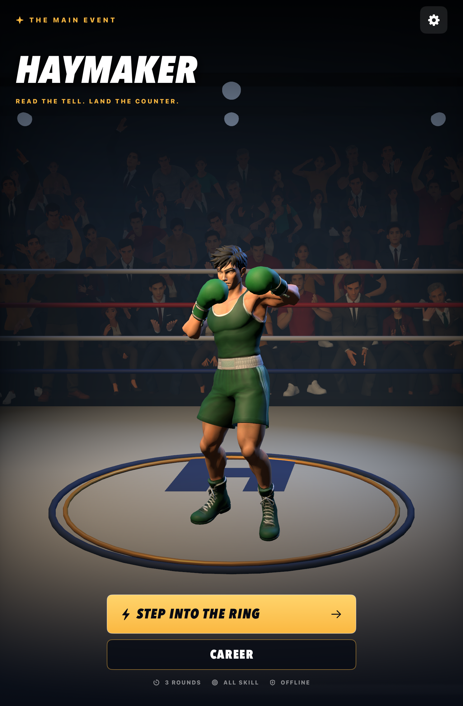
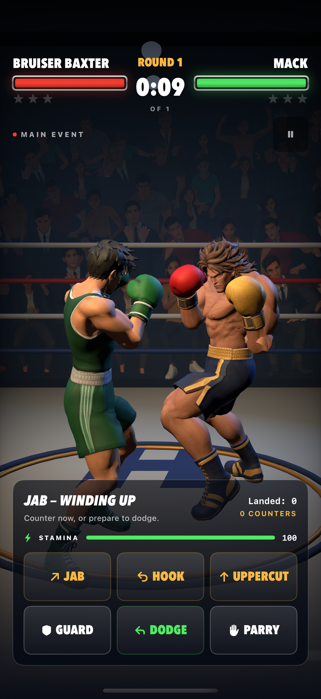
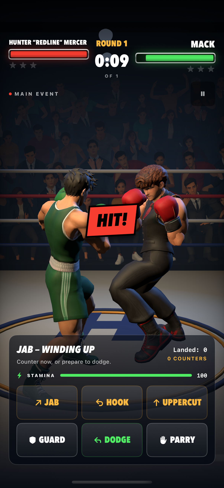
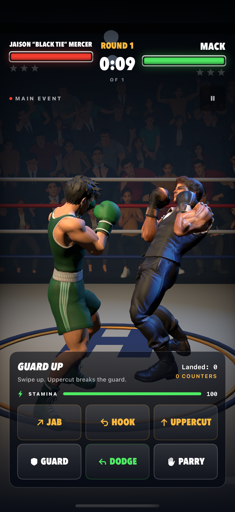

# Character model source assets

These ten OBJ files were supplied by the user for character integration. The original nine exports were visually verified in T-pose; Jaison is a supplied vertex-colored sculpt using the same rig builder. They are stored here as art source assets, outside the app's synchronized resource directory. The ZIP archives for Atlas, Duke, Goldie, Mack, and Vera contain additional supplied OBJ/material/texture exports and are preserved alongside the vertex-colored sources. The rig builder uses the named `.obj` files listed below so its verified exports remain reproducible.

| File | Character | Vertices | Faces |
| --- | --- | ---: | ---: |
| `mack.obj` | Mack, the player | 11,057 | 21,736 |
| `goldie.obj` | Goldie Voltage | 10,418 | 20,735 |
| `nico.obj` | Nico “Nightshift” Navarro | 10,864 | 21,095 |
| `bruiser.obj` | Bruiser Baxter, the final boss | 10,962 | 21,421 |
| `atlas.obj` | Atlas “Undertow” Reed | 21,000 | 22,375 |
| `duke.obj` | Duke Doubletake | 21,581 | 23,026 |
| `sylvie.obj` | Sylvie “Slipstream” Sloane | 21,038 | 22,438 |
| `cassian.obj` | Cassian “Saint” Sterling | 21,215 | 23,190 |
| `vera.obj` | Vera Velvet | 21,821 | 22,492 |
| `jaison.obj` | Jaison “Black Tie” Mercer | 4,824 | 9,644 |

The files are preserved byte-for-byte from the supplied exports. Their headers identify Blender 5.0.1. Vertex records include RGB colors; there are no external material-library references, UV coordinates, or exported normals. The offline rig builder preserves vertex colors and generates area-weighted smooth normals. OBJ does not carry a skeletal rig or animation, so T-pose alone does not make these assets animation-ready. The runtime exports normalize each sculpt to 2.7 scene units, preserve Y-up/+Z-front orientation, and skin it to the shared Mixamo-compatible 22-bone skeleton described in [`../Rigs`](../Rigs/README.md).

The subsequent exports contain mixed triangle and quad faces. Unlike the initial four triangulated models, these need triangulation if the destination renderer requires triangles.

| Model | Triangles | Quads |
| --- | ---: | ---: |
| Atlas | 3,379 | 18,996 |
| Duke | 3,518 | 19,508 |
| Sylvie | 3,773 | 18,665 |
| Cassian | 4,734 | 18,456 |
| Vera | 2,613 | 19,879 |

See [character backstories](../character-backstories.md) for roles and story direction. The bundled `.fighter` meshes in `Haymaker/Models` are generated by `python3 scripts/rig_fighters.py`. Mack and Bruiser replace the prototype fighters in the current bout; the other eight opponents are integrated in career and sparring. All ten story characters now have source models.

Each rig uses Mixamo's bone set and hierarchy:

- Hips
- Spine, Spine1, Spine2, Neck, Head
- Shoulder, Arm, ForeArm and Hand on each side
- UpLeg, Leg, Foot and ToeBase on each side

Joints are fitted per sculpt and calibrated against Mixamo's own fit for Mack. The skin weights are what keep the meshes from deforming:

- Each glove follows only its hand bone (rigid), so gloves don't stretch.
- Boots and head are rigid too.
- No weight crosses between the left and right limbs.
- Knees, hips and elbows blend over a short span, so legs bend without the old pinching.

Every pose starts from motion capture in the shared clip library ([`../Animations`](../Animations/README.md)). On top of the clips, the runtime layers only:

- cross-fades between clips;
- separate lower-body and arm clocks;
- foot planting with deliberate steps;
- punch aim that releases at contact;
- additive hit reactions;
- breathing;
- fighter spacing.

The binary `HMR2` layout is little endian, in this order:

1. A 16-byte header: magic, vertex count, index count, bone count (22).
2. 28-byte bone records: signed parent index, global head XYZ, and an aim point along the bone.
3. 60-byte vertices: position, normal and RGB, then four float weights and four UInt16 bone indices.
4. UInt32 triangle indices.

Source OBJs are unchanged.

`python3 scripts/test_rig_fighters.py` checks:

- byte-exact rebuilds;
- the skeleton contract;
- normalized weights, rigid gloves, boots and head;
- no cross-side weights;
- the roster-to-asset mapping.

`python3 scripts/test_fighter_clips.py` checks the clip library.

For current runtime verification, run the Godot game and inspect fighter animation, contact and textures in its arena. The following legacy render probe and screenshots document historical asset verification only; they are not maintenance instructions or evidence of a Godot export.

The legacy `scripts/verify_fighter_rigs.sh` probe exercised scripted bouts and punch combinations for every fighter. It checked:

- no pose pops;
- foot slide and leg stretch limits, with smoothly eased release steps into knockdowns;
- windup travel and pace within limits, even when the engine's impact window is short;
- glove-to-target contact;
- no body interpenetration;
- hit-reaction latency;
- the knockdown get-up reaching guard on the engine's rise tick.

It produced guard grids, per-frame filmstrips and match frames.

Known limits of linear-blend skinning:

- The crotch stretches while lying flat in the knockdown.
- Victory and lying poses can sink the feet or seat by a few centimetres.

Both are brief and clamped by the runtime.

## Historical rendered verification

These archived renders came from the legacy `scripts/verify_fighter_rigs.sh` probe, not Godot.

Guard pose (idle frame 0). Top row, left to right: Mack, Bruiser, Goldie, Nico, Atlas. Bottom row: Duke, Sylvie, Cassian, Vera, Jaison.


Mack vs Bruiser match frames through the game camera:

- tells, contacts and blocks for every punch;
- slips, parries and hit reactions;
- knockdowns, the taunt and get-ups;
- the knockout and victory.


Every frame of a hero jab → hook → uppercut chain. The follow-up punches close distance with short, planted steps.


The rival's three-second knockdown: fall, taunt, get-up and back to guard.


## Size and performance report

[`asset-report.md`](asset-report.md) lists per-rig payload, vertex/triangle counts, estimated GPU buffers and roster mapping. Regenerate with `python3 scripts/fighter_asset_report.py`. Godot loads runtime rigs through `godot/scripts/arena/fighter_assets.gd`; validate missing/malformed asset behavior in that runtime. On-device frame times are not yet measured.

Jaison’s source is the user-supplied `jaison.obj`. It has 4,824 colored vertices and 9,644 triangle faces, with no external material references. Its runtime rig uses the shared 22-bone HMR2 format. Positions, faces and body colours are unchanged from the supplied file; only the gloves were repainted. The generator had baked the reference art’s rim lights into them (gold on the right glove, blue on the left), so in game the right glove read as tan. The 336 vertices past the wrist (T-pose |x| ≥ 0.342) now match `jaison.png`: white cuffs up to |x| 0.388, then black leather gloves with soft highlights.

## Hunter Rowan Mercer — “Redline”

User-supplied original character assets received October 19, 2026: `hunter.obj`, `hunter.png` (versus portrait), and `hunter-defeated.png` (bundled unchanged for victory results). The OBJ is rigged with the existing offline pipeline; runtime uses the generated `hunter.fighter`. No external stock assets.

## Fighter texture fidelity

All eleven fighters use the original base-color JPEGs from supplied model exports. `python3 scripts/rig_fighters.py` verifies exact position and face correspondence, then generates `.fighteruv` seam mappings and `-basecolor.jpg` images alongside the unchanged `.fighter` rigs. UV seams duplicate render vertices with identical normals and skin weights; contact geometry stays unchanged. Textured meshes use white vertex colors to avoid multiplying the original paint into the texture a second time. The vertex-colored mesh remains available as a fallback if texture resources are missing or malformed. No new external art or generated detail is introduced.

The runtime consumes base color; additional material maps supplied for Jaison are not yet wired into this pipeline. Missing or malformed UV sidecars retain the vertex-colored mesh. Run `python3 scripts/test_rig_fighters.py` to check byte-exact texture regeneration, UV seams and triangle correspondence as well as rig integrity. The simulator screenshots below are historical asset evidence, not current Godot validation or physical-device performance measurements.

### Texture orientation verification

HMT1 coordinates use the image's top-left origin: `u = OBJ.u`, `v = 1 - OBJ.v`. Incorrect image-origin mapping places skin and clothing fragments on unrelated surfaces. The exporter applies the conversion once; runtime materials must not flip it again. The regression suite compares every exported triangle corner with the original OBJ UV using this convention.

The legacy title screen was built and run on the iPad mini (A17 Pro) simulator with iOS 27.0 / Xcode 27.1. This archived screenshot does not verify the planned Godot iOS export.



### Bruiser textured source

Bruiser's `bruiser.zip` is a derived OBJ/MTL/JPEG export from the user-supplied `tripo_convert_4c5eb2b5-4259-4541-92eb-0dcc141f0134.fbx` and its `bruiser_basecolor.JPEG`, received October 21, 2026. Blender 5.2.1 recovered the FBX per-corner UVs. After converting Blender's imported Z-up positions to the existing Y-up OBJ coordinates `(x, z, -y)`, all 10,962 vertices matched uniquely within 0.000002 source units (maximum error 0.000001051). All 21,421 triangles matched by vertex identity. The derived OBJ uses the existing rig source's exact positions, vertex order and triangle winding with the corresponding FBX UVs; the JPEG is byte-exact. The `.fighter` rig, skin weights and animations are unchanged. `scripts/rig_fighters.py` rebuilds the runtime UV sidecar and texture from this archive, and the regression suite checks topology and image-origin conversion.

### Remaining FBX texture sources

Hunter, Jaison, Nico, Sylvie and Cassian were supplied October 21, 2026, alongside their original base-color images:

| Fighter | Supplied FBX conversion ID | Vertices | Polygons |
| --- | --- | ---: | ---: |
| Hunter | `bf0e14e7-2fa1-405f-b4ee-e941a4a99aec` | 5,316 | 10,435 |
| Jaison | `24b20659-6ee8-41a7-a00e-ef96e363b83a` | 4,824 | 9,644 |
| Nico | `8d57a32d-fe28-49de-9801-f4499a9d0e14` | 10,864 | 21,095 |
| Sylvie | `41ad7a54-fd45-4ec3-b3d7-ab0da4c70c2d` | 21,038 | 22,438 |
| Cassian | `8a54768e-8454-4de6-a8a0-001473405b2d` | 21,215 | 23,190 |

`scripts/blender/recover_fighter_texture.py` recovers the supplied FBX's per-corner UVs onto the exact existing OBJ vertex/polygon order. Every vertex must match within 0.000002 source units; coincident positions are resolved through mesh connectivity, then the full polygon identity and bijection are checked. The maximum observed position error for these five exports is below 0.000000876 source units. It rejects mismatched meshes rather than guessing a UV transfer. The resulting `<fighter>.zip` archives contain the canonical OBJ, MTL and byte-exact source JPEG, so runtime regeneration remains deterministic and needs no Blender. Jaison's new texture retains the baked warm/cool highlights in the supplied base-color image, replacing the earlier vertex-only glove repaint.

To recover an export again:

```sh
blender --background --python scripts/blender/recover_fighter_texture.py -- \
  --name hunter --fbx /path/to/source.fbx --basecolor /path/to/hunter_basecolor.JPEG
python3 scripts/rig_fighters.py hunter
```

Bruiser in a live bout on the iPhone 18 Pro / iOS 27.0 simulator:



### Historical full-roster simulator validation

The legacy game completed live sparring bouts against all ten opponents on the iPhone 18 Pro / iOS 27.0 simulator with the final texture assets. Every saved bout screenshot was visually inspected for skin, clothing and glove placement. Mack's title screen also passed the portrait/landscape journey, and the iPad mini (A17 Pro) simulator was updated to that build. These are historical results, not requirements to maintain or rebuild the legacy game.

Host verification passed 81 engine tests, six store tests, the session adapter checks, 12 fighter asset tests, six display contract checks, and the native-only/zero-network gates. Runtime additions for the six recovered exports total 13.29 MiB of JPEG and UV sidecars; original `.fighter` geometry, skin weights and animation clips are byte-identical.




