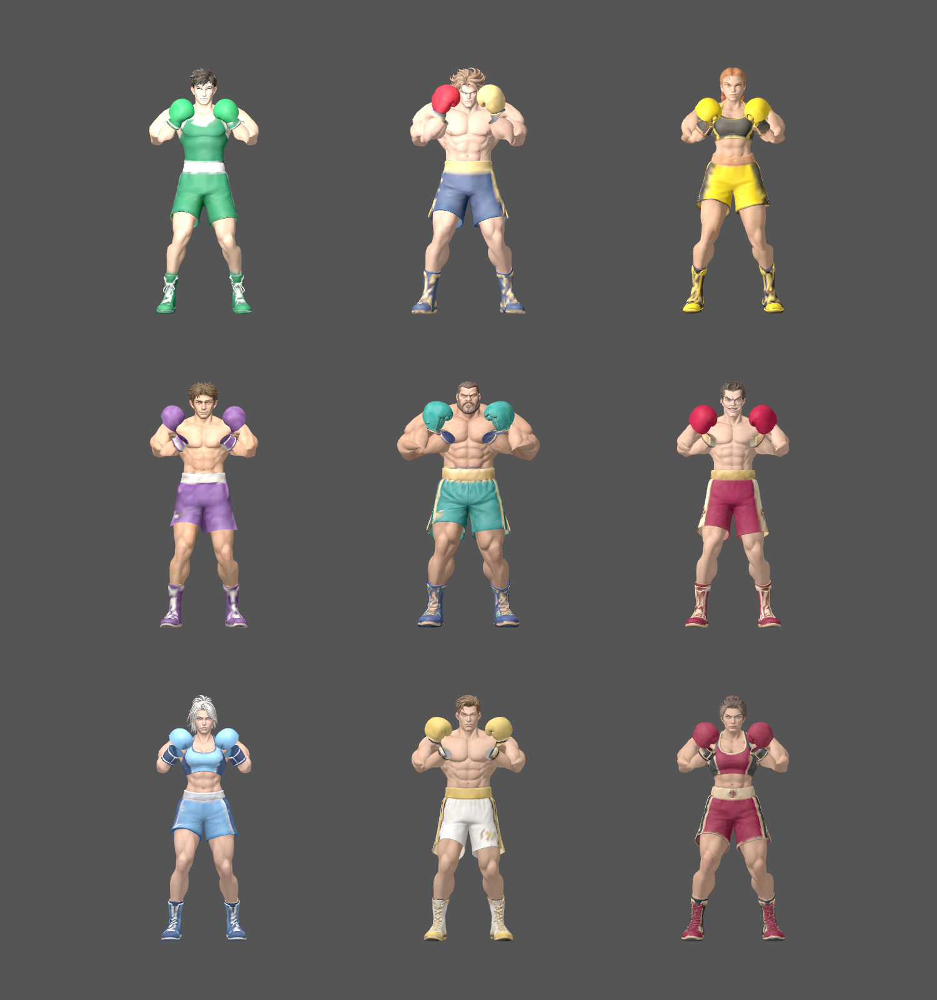
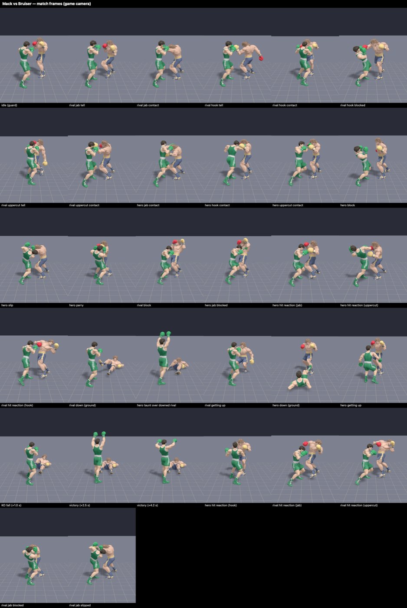
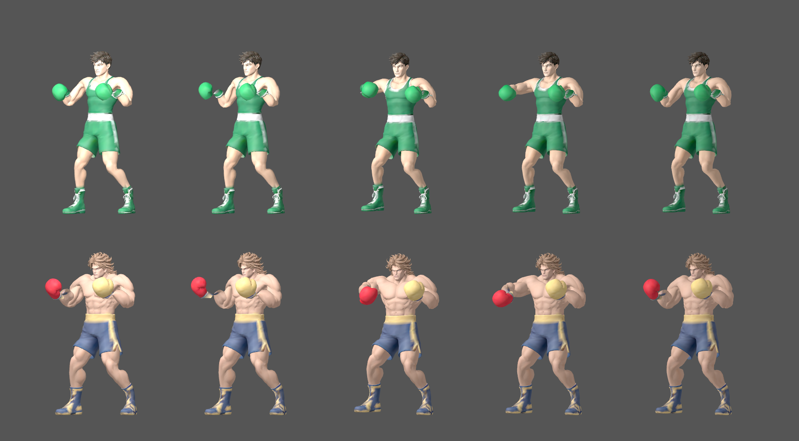

# Character model source assets

These nine OBJ files were supplied by the user for character integration. All nine exports have been visually verified in T-pose. They are stored here as art source assets, outside the app's synchronized resource directory. The ZIP archives for Atlas, Duke, Goldie, Mack, and Vera contain additional supplied OBJ/material/texture exports and are preserved alongside the vertex-colored sources. The rig builder uses the named `.obj` files listed below so its verified exports remain reproducible.

| File | Character | Vertices | Faces |
| --- | --- | ---: | ---: |
| `mack.obj` | Mack, the player | 11,057 | 21,736 |
| `goldie.obj` | Goldie Voltage | 10,418 | 20,735 |
| `nico.obj` | Nico “Nightshift” Navarro | 10,864 | 21,095 |
| `bruiser.obj` | Bruiser Baxter, the final boss | 10,962 | 21,421 |
| `atlas.obj` | Atlas “Undertow” Reed | 21,000 | 22,375 |
| `duke.obj` | Duke Doubletake | 21,581 | 23,026 |
| `sylvie.obj` | Sylvie “Slipstream” Sloane | 21,038 | 22,438 |
| `cassian.obj` | Cassian “Saint” Sterling | 21,215 | 23,190 |
| `vera.obj` | Vera Velvet | 21,821 | 22,492 |

The files are preserved byte-for-byte from the supplied exports. Their headers identify Blender 5.0.1. Vertex records include RGB colors; there are no external material-library references, UV coordinates, or exported normals. The offline rig builder preserves vertex colors and generates area-weighted smooth normals. OBJ does not carry a skeletal rig or animation, so T-pose alone does not make these assets animation-ready. The runtime exports normalize each sculpt to 2.7 scene units, preserve Y-up/+Z-front orientation, and attach a 16-bone skeleton.

The subsequent exports contain mixed triangle and quad faces. Unlike the initial four triangulated models, these need triangulation if the destination renderer requires triangles.

| Model | Triangles | Quads |
| --- | ---: | ---: |
| Atlas | 3,379 | 18,996 |
| Duke | 3,518 | 19,508 |
| Sylvie | 3,773 | 18,665 |
| Cassian | 4,734 | 18,456 |
| Vera | 2,613 | 19,879 |

See [character backstories](../character-backstories.md) for roles and story direction. The bundled `.fighter` meshes in `Haymaker/Models` are generated by `python3 scripts/rig_fighters.py`. Mack and Bruiser replace the prototype fighters in the current bout; the other seven rigs are ready for future roster integration. All nine story characters now have source models.

Each rig includes hips/spine/neck/head, shoulders/elbows/hands and hips/knees/feet. Skin weights isolate the jaw from the body and arms; only the lower neck blends. Head yaw is limited to three degrees, with recoil applied to the torso. Two-bone arm and leg solvers preserve limb lengths during guard, telegraph, jab, hook, uppercut and bent-knee shuffle poses. Wrist roll corrects the glove orientation and turns the punching fist over. The presentation retains the last strike through engine recovery, easing the glove back into guard instead of snapping it home. Slow chest expansion is layered over body sway and weight shifts; the pair gently circles while facing each other. Ambient motion is suppressed with reduced motion enabled. The binary `HMR1` layout is little endian: a 16-byte header (magic, vertex count, index count, bone count), 16-byte bone records (signed parent index and global bind XYZ), 60-byte vertices (position/normal/RGB, four float weights and four UInt16 bone indices), then UInt32 triangle indices. Source OBJs are unchanged.

Validate deterministic exports, indices, normals, normalized weights and face isolation with `python3 scripts/test_rig_fighters.py`. On macOS with Xcode, `bash scripts/verify_fighter_rigs.sh` exercises 216 combat pose combinations per model through the actual SceneKit loader and checks tell/strike/recovery continuity, wrist orientation, knee bend, shuffles, breathing and reduced-motion stability. It renders `/tmp/haymaker-rig-guard.png` and `/tmp/haymaker-rig-guard.motion.png`. Joint placement and skin weights are procedural and may benefit from hand-painted refinements for future extreme animations; current poses deliberately avoid extreme neck movement.

## Rendered verification

Guard poses, left to right: Mack, Bruiser, Goldie; Nico, Atlas, Duke; Sylvie, Cassian, Vera.

Mack and Bruiser, left to right: guard, chamber, contact, retraction, returned guard.

